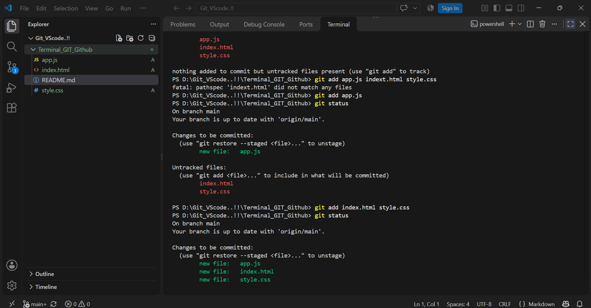
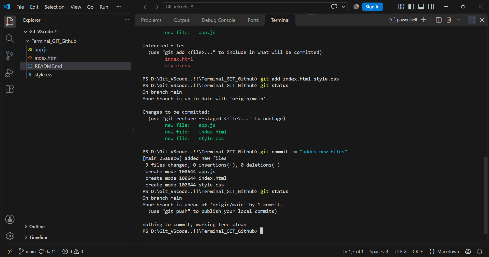
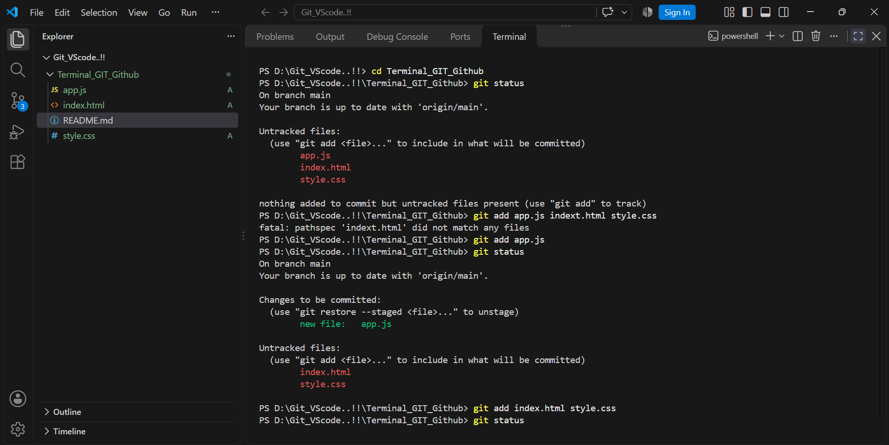
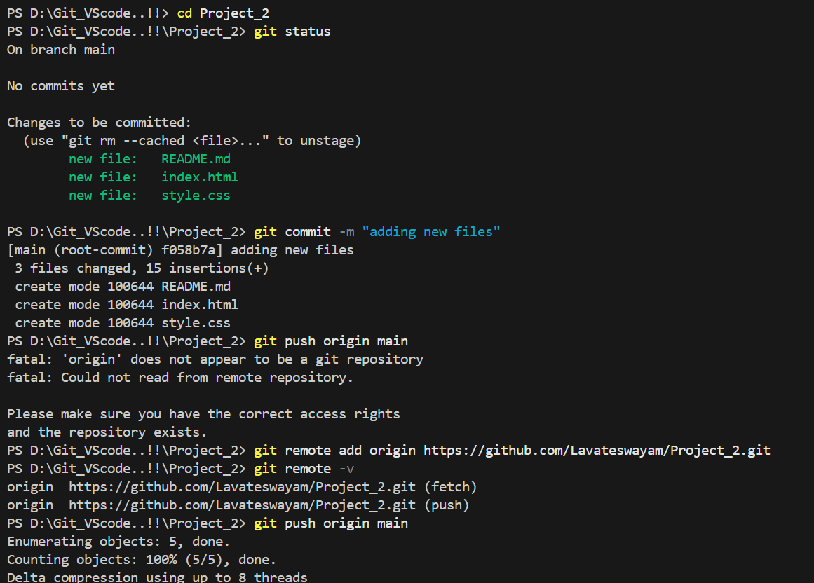
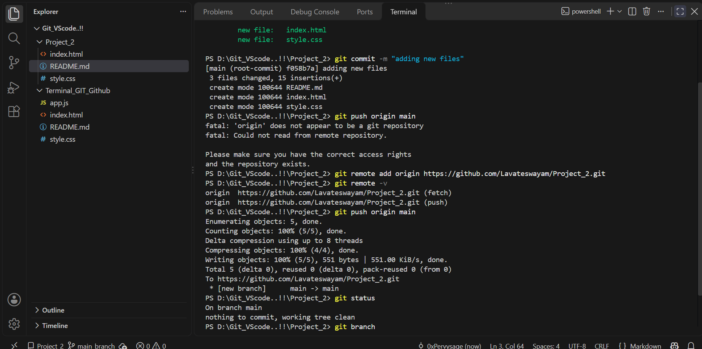

# Project_2

this project was created by local system using Vs-code terminal.

# 2026-11-19: Git Commands

## 1. Clone command
- Syntax: `git clone <repo-link>`
- Can be used to modify the repository files in VS Code using the git clone command.

> **Extra:** `git clone` downloads a full copy of a GitHub repo (all files and history) to your computer, inside a new folder. After that you can open the folder in VS Code and edit.

## 2. Status command
- Syntax: `git status`

> **Extra:** The command you will use most. It shows which files are untracked (new), modified, or staged. Run it before and after every `add` and `commit`.

## 3. Add command
- Syntax: `git add <filename>`
- This command adds / makes the process as **staged**, which will commit at last.

> **Extra:** Staging means choosing which changes go into the next commit. Think of it as putting items in a box before sealing it.

## 4. Commit command
- Syntax: `git commit -m "message"`
- This is the final step to save the files: commit it.
- Commit is a **two-staged process**, i.e. add + commit.

> **Extra:** The message should say what changed, like `"Add terminal notes"`. Avoid messages like `"update"` or `"abc"`.
> **Correction:** `-m` is a flag that lets you write the message directly. Without it, Git opens a text editor and asks for one.

## 5. Push command
- Syntax: `git push origin main` (`main` is the **branch**)
- This step is used to push the code or anything else, to make our project up to date.

> **Extra:** `origin` is the nickname of your GitHub repo link, and `main` is the branch you are pushing. So the command means "send my commits to GitHub, on the main branch".

## 6. Init command
- Syntax: `git init`
- Used to create a new git repo.
- `git add .` = adds all the untracked files.

> **Extra:** `git init` creates a hidden `.git` folder, and that folder is the repository. Delete it and the folder is no longer a Git project.
> **Extra:** The `.` in `git add .` means "the current folder". It stages all new and modified files in it, so check `git status` first. This is how a `.env` or secret file gets staged by mistake, which is why `.gitignore` matters.

## 7. Remote add origin
- Syntax: `git remote add origin <link>`
- This, in simple words, connects the GitHub repo to the local system repo.

> **Correction:** They don't become one single repo. You still have two copies, one on your computer and one on GitHub. This command only tells your local repo where the GitHub copy lives, and `push` / `pull` keep them in sync.

## 8. Remote -v
- Syntax: `git remote -v`
- This verifies whether the repo is connected or not.

> **Extra:** It lists the connected remote links. If it prints nothing, no GitHub repo is connected yet. (`-v` means verbose.)

## 9. Branch
- Syntax: `git branch`
- Shows the branches, and the current branch is the one we are working on.

> **Extra:** The current branch is marked with `*`. A branch is a separate line of work, like a parallel copy where you can try things without touching the main one.

## 10. Branch -M main
- Syntax: `git branch -M main`
- This is used to rename the branch.

> **Extra:** Older Git versions name the first branch `master`. This renames it to `main` to match GitHub. `-M` forces the rename.

## 11. Push -u origin main
- Syntax: `git push -u origin main`
- This flag sets up everything else to push on the main branch and don't ask again for origin.

> **Extra:** `-u` (upstream) links your local `main` to GitHub's `main`. After the first time, a plain `git push` or `git pull` is enough.
> **Correction:** The flag is `-u`. Double-check how you wrote it in your notebook.

---

## The whole flow in one place (extra)
**Starting a new project and putting it on GitHub:**
```bash
git init
git add .
git commit -m "First commit"
git branch -M main
git remote add origin <repo-link>
git remote -v
git push -u origin main
```

**Starting from an existing GitHub repo:**
```bash
git clone <repo-link>
cd <folder-name>
# edit files
git status
git add .
git commit -m "Describe the change"
git push
```

## Quick revision (extra)
1. `clone` = download a repo, `init` = start a new one.
2. `status` = what is going on right now.
3. `add` = stage, `commit` = save a snapshot, `push` = send to GitHub.
4. `remote add origin` = connect to GitHub, `remote -v` = verify.
5. `branch` = list branches, `branch -M main` = rename.
6. `push -u origin main` = push and remember the link.

## Safety habits (extra)
- Run `git status` before every commit.
- Never commit passwords, private keys, seed phrases, or `.env` files. Once pushed, they stay in history even if you delete them later.
- Use `.gitignore` for files Git should not track.
- Public repos are visible to everyone, so check what you are adding.

## Practice
- Make a new folder, run `git init`, create a file with `touch`, and go through `status`, `add`, `commit`, `log`.
- Create an empty repo on GitHub, connect it with `remote add origin`, verify with `remote -v`, and push with `-u`.
- Clone any repo and run `git status` and `git branch` inside it.

## Workflow 




